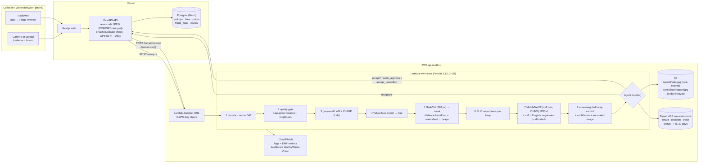
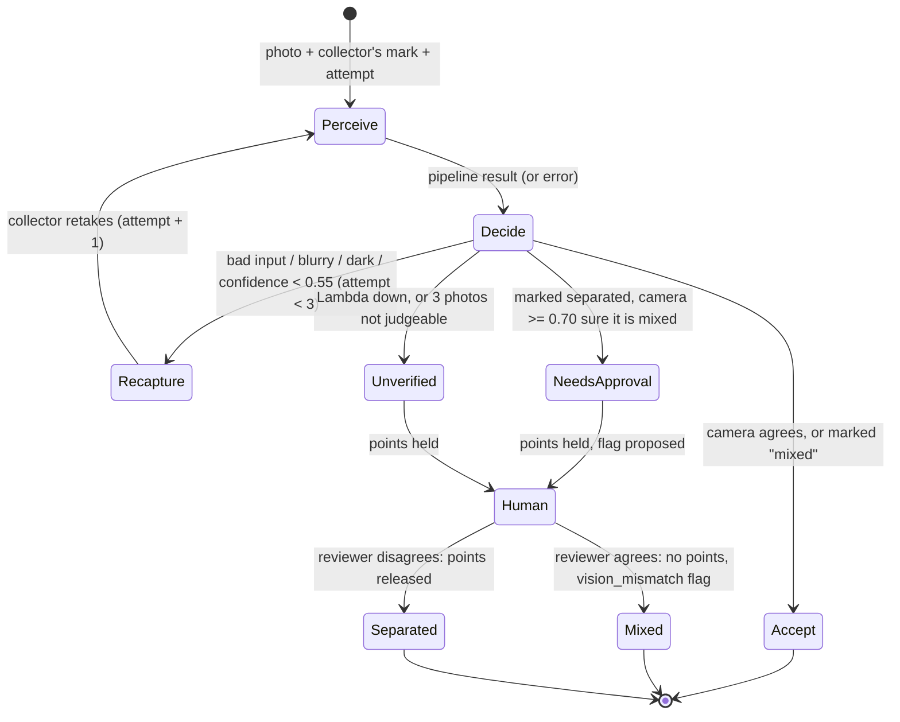

# Architecture

WorthyWaste runs as two parts. The **app** is on Vercel: Next.js web, FastAPI API and Postgres. The **vision
service** is on AWS: Lambda, S3, DynamoDB and CloudWatch. The API is the only thing that calls the vision service,
and every call carries a shared secret.

## The agent loop

The agent never holds a household's points or flags a collector on its own: it **proposes** that, and a person
decides in `/ops` (or on `/vision`, where the visitor plays the reviewer for their own demo run).

## Where failures go

| Failure | Handling |
| --- | --- |
| Not an image / under 64 px | `bad_input` → recapture |
| Blurry (Laplacian var < 60), too dark (< 45) or too bright (> 235) | `low_quality` → recapture, not judged |
| GrabCut finds < 8% waste | whole frame judged as one heap (`segmentation_fallback`) |
| Classifier unsure | unsure parts (p < 0.75) don't vote; low overall confidence → recapture |
| Exception inside the pipeline | caught in the Lambda → `accept_unverified` |
| Lambda timeout / network / 5xx | caught in the API (`_vision_pickup`) → `accept_unverified`; reason on `/api/health` |
| Two reviewers at once | DynamoDB conditional update and a guarded SQL `UPDATE ... WHERE review = 'pending'` → second gets 409 |
